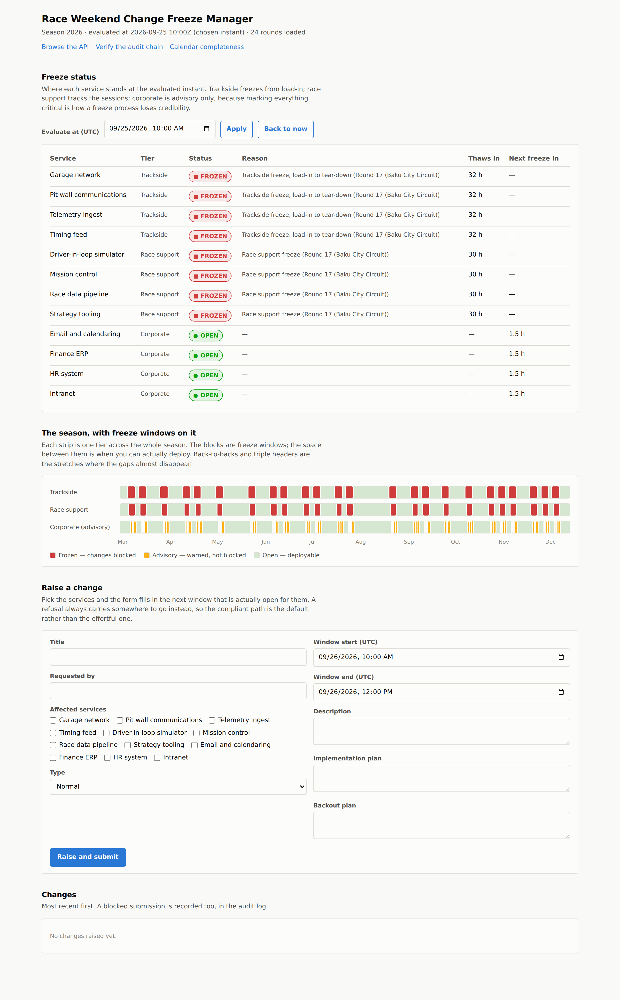
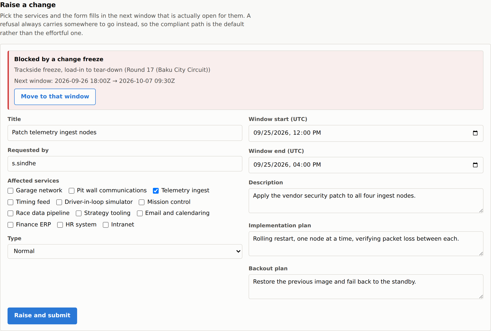
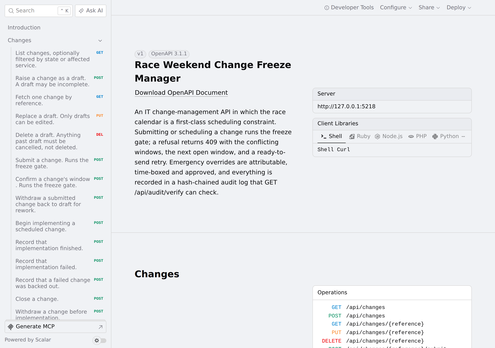

# Race Weekend Change Freeze Manager

[](https://github.com/Sachin-1712/carlos-sainz/actions/workflows/ci.yml)

**The problem.** A racing team cannot patch its systems whenever it likes — the race calendar
decides when breaking something is survivable, and the calendar is not negotiable.

**What it does.** Engineers raise IT change requests; the system knows every session of every race
weekend, derives freeze windows from that calendar per service, and refuses to schedule work into
one — while always naming the next window the change would fit.

**The twist.** Emergencies still get through, but only via a time-boxed override that costs a named
approval chain, a linked incident, and a permanent, tamper-evident audit entry.

**The proof.** 341 tests, a live calendar sync that survived two rounds being cancelled mid-season
with no code change, and an audit log whose hash chain names the row if anyone edits the database
behind it.

*Tech:* .NET 10 · C# · minimal API · Blazor Server · EF Core / SQLite · xUnit · GitHub Actions



> **Portfolio project.** Not affiliated with, endorsed by, or derived from any Formula 1 team's
> internal systems. All data is seeded or fetched from public sources.

## Why the calendar matters

Corporate IT change freezes are calendars of convenience: month-end, Black Friday, the Christmas
shutdown. Someone picks them, and someone can move them.

A racing team's freeze is different. It is externally imposed, non-negotiable, and it moves without
asking. The FIA publishes when you are allowed to break things. Nobody in your change process gets
a vote, and a session that slips because of weather drags every dependent freeze window with it.

That single difference is what this project is built around.

## A refusal that is worth obeying

The hard part of change control is not blocking things. It is being a control people use rather
than route around — and a control that is routed around also stops telling you the truth about what
is being changed.

So a refusal here always carries somewhere to go instead. Over HTTP, a blocked submission returns
`409` with the conflicting windows, the next window long enough for *this* change, and a
`retryWith` object that is a complete request which would succeed:

```json
{
  "title": "Blocked by a change freeze",
  "detail": "Blocked by 1 freeze window(s); next window opens 2026-09-26 18:00Z",
  "conflicts": [
    { "reason": "Trackside freeze, load-in to tear-down (Round 17 (Baku City Circuit))", "rounds": [17] }
  ],
  "suggestedOpenWindow": { "startUtc": "2026-09-26T18:00:00+00:00", "durationHours": 255.5 },
  "retryWith": {
    "method": "POST",
    "path": "/api/changes/CHG-2026-0001/submit",
    "body": {
      "requestedStartUtc": "2026-09-26T18:00:00+00:00",
      "requestedEndUtc": "2026-09-26T22:00:00+00:00"
    }
  }
}
```

Posting `retryWith` back unmodified moves the change and submits it. Note it keeps the change's own
four hours rather than expanding to fill the 255-hour gap.

In the dashboard the same idea arrives one step earlier: ticking a service shows the next open
window *before* anyone types a date, so the compliant path is the lazy one.



## What the 2026 season did to it

The season changed under the tool while it was being built, which is the best test it could have had.

Two rounds were cancelled mid-season. One was reinstated as a different race, in a different
country. One race moved from Sunday to Saturday.

**None of that was a code change.** Every one of those is a property of the calendar, not of the
engine:

| What happened | Why no code changed |
| --- | --- |
| Two rounds cancelled | `Cancelled` is a first-class event status. The engine excludes them from freeze calculation but keeps the round resolvable, so a change record that referenced one still reads. |
| A replacement round in another country | A new event with its own sessions, circuit and IANA time zone. The freeze policy is written as anchors and offsets, so it applies to the new round without being told about it. |
| A race moved to Saturday | Freeze windows are anchored to sessions, not to weekdays. Moving the race moves every window that depends on it. |

A re-sync was the whole fix. That is what "the calendar is a first-class constraint" buys: the
constraint moves, and the code does not.

The part that *did* need work was the bundled seed. A hand-written fallback drifts the moment the
season changes — which is not harmless, because a stale seed is a calendar with the wrong races in
it that the engine will treat as authoritative when upstream is down. So the seed is now generated
from a verified sync, and the drift between the two is checked at startup and at
`GET /api/calendar/{season}/seed-drift`.

## Why these freeze offsets

<!-- Owner to write. The numbers the engine currently runs with are below; the reasoning is not
     mine to assert. -->

*To be written by the service owner.*

The numbers in `FreezePolicySet.Default` today, which exist so the engine has something to run and
are **not yet decided**:

| Tier | Freeze from | Until |
| --- | --- | --- |
| Trackside | 48 h before the first session | 2 h after parc fermé release |
| Race support | 24 h before the first session | 3 h after the race |
| Corporate | 30 min before each session (advisory only) | 30 min after |

They are data, not code — one edit in `FreezePolicySet.cs`, no release.

## What the tests prove

**341 tests** — 340 passing, one skipped because it calls the live calendar API. No mocks in the
domain suite, no clock, no I/O: each test is a statement about the domain. The six worth reading:

- Back-to-back races leave a 65-hour window for trackside services and nothing more.
- A triple header has no gap long enough for a four-day change, so the engine pushes it past all
  three rounds rather than offering a window that does not fit.
- A Saturday-night race in Las Vegas keeps a European factory frozen into Sunday morning.
- A session delayed forty-five minutes by a red flag drags its freeze out with it.
- The same weekend described in UTC, US central and Japan standard time produces byte-identical
  freeze windows.
- An audit row cannot be updated or deleted through the application at all; edited directly in the
  database, the hash chain names the entry that changed.

## Approvals, overrides and the audit trail

### The chain scales with the blast radius

| Strictest tier touched | Who has to approve |
| --- | --- |
| Corporate | Service owner |
| Race support | Service owner, head of IT |
| Trackside | Trackside IT lead, head of IT, race engineering nominee |

Trackside adds race engineering because touching a trackside system during a session has sporting
consequences, not only IT ones. A standard change is pre-approved and skips the chain — but it is
still subject to the freeze, and an override for one still needs an approver.

### Emergency override

The only way through a freeze, and a control rather than a bypass because it is three things at
once:

- **Attributable** — a linked incident reference and a written justification, both required.
- **Time-boxed** — a grant expires on its own (two hours by default, twelve maximum), and the
  expiry is written to the audit log by a sweeper, so a standing exemption cannot accumulate.
- **Accountable** — it takes the same approval chain the change's tier demands.

**Break-glass** is the narrower door for when the chain cannot be assembled at 02:00: one approver,
but only the head of IT or the trackside IT lead, and it costs a mandatory retrospective within 24
hours. It exists because the alternative is people working around the tool entirely.

### What an emergency looks like in the log

Raising an emergency change during a race weekend, being refused, overriding it and going ahead
produces this, each entry hash-linked to the one before it:

```
#1   ChangeRaised               s.sindhe                 98f818472d... <- 0000000000...
#2   ChangeBlockedByFreeze      s.sindhe                 36cd3bb86a... <- 98f818472d...
#3   OverrideRequested          s.sindhe                 15a0e12014... <- 36cd3bb86a...
#4   OverrideApprovalRecorded   TracksideItLead.person   bd84e63341... <- 15a0e12014...
#5   OverrideApprovalRecorded   HeadOfIt.person          065716aa3c... <- bd84e63341...
#6   ChangeBlockedByFreeze      s.sindhe                 ec72418810... <- 065716aa3c...
#7   OverrideApprovalRecorded   r.nominee                87b6112218... <- ec72418810...
#8   OverrideGranted            r.nominee                23957750f2... <- 87b6112218...
#9   OverrideUsed               s.sindhe                 5f819fdea0... <- 23957750f2...
#10  ChangeSubmitted            s.sindhe                 e1d5575bdc... <- 5f819fdea0...
```

Both refused attempts (#2, #6) are in the log. A refusal is exactly the thing a change process needs
to be able to count later: a rising number of them says a freeze policy is wrong somewhere.

### Tamper evidence, and its limits

`GET /api/audit/verify` walks the chain. Editing a row directly in the database — behind the
application, where the append-only interceptor cannot reach — is caught:

```
HTTP 409
  isValid:             False
  firstBrokenSequence: 3
  reason:              Entry 3 has been altered: the stored hash does not match its contents.
```

Two layers: a `SaveChanges` interceptor refuses any update or delete of an audit row, and the hash
chain catches anyone who goes around it.

The honest claim is **detection, not prevention**. Someone with write access could recompute the
whole chain, and entries removed from the *end* cannot be detected by a chain alone — nothing links
forward. The verify response says so in a `scope` field rather than letting a green tick be
over-read.

## Running it

Requires the .NET 10 SDK. No other tooling — no npm, no bundler.

```bash
dotnet run --project src/FreezeManager.Api
```

| | |
| --- | --- |
| `/` | The dashboard |
| `/scalar/v1` | Browsable API reference |
| `/api/audit/verify` | Walk the audit hash chain |
| `/api/calendar/2026/completeness` | Check the calendar for holes |

For something to look at on a fresh clone, `tools/demo-data.sh` drives the public API to produce a
real audit trail — a change refused by the freeze and rescheduled into the window it was offered, a
clean change run through to closed, and an emergency refused then overridden through its full
approval chain:

```bash
dotnet run --project src/FreezeManager.Api &
tools/demo-data.sh http://localhost:5000
```

On first run the app applies migrations, seeds the service catalogue, and pulls the calendar — live
if the API is reachable, from the bundled seed if not. Either way the attempt is recorded and readable
at `GET /api/calendar/sync-runs`, including the reason for a fallback.



## Architecture

```
src/
  FreezeManager.Domain/          pure C#, zero dependencies — freeze engine, lifecycle, audit chain
  FreezeManager.Infrastructure/  EF Core over SQLite, calendar providers, sync, audit writer
  FreezeManager.Api/             minimal API, Scalar, and the Blazor dashboard
tests/
  FreezeManager.Domain.Tests/          fast, deterministic, no I/O
  FreezeManager.Infrastructure.Tests/  in-memory SQLite through the real migrations
  FreezeManager.Api.Tests/             the real HTTP surface, in-memory database
data/seed/                       cold-start calendar, illustrative service catalogue
```

The domain project has no dependency on EF Core, ASP.NET, HTTP, or the system clock. The freeze
engine is a pure function of `(calendar, service tiers, instant)`, which is what makes the test
suite readable as a statement of the domain rather than a set of mocks — and what let the dashboard
add "evaluate at any instant" for the cost of a query parameter.

The freeze gate runs on `Draft -> Submitted` and `Approved -> Scheduled` — the two points at which
a window is claimed. Approval sits between them and does not re-run the gate, because approving a
change agrees to the work, not to the slot. The transitions are a table rather than a chain of
conditionals, which is why inserting the approval states was an edit to data.

Every design decision is recorded in [`docs/decisions.md`](docs/decisions.md) — 48 entries, each
written as *what was chosen, why, what it would cost to get wrong, and the sentence to open with if
asked*. The endpoint list is in [`docs/api.md`](docs/api.md); build, migration and ingestion detail
is in [`docs/development.md`](docs/development.md).

## How this was built

<!-- Owner to write. -->

*To be written.*

## Known limits

- **There is no authentication.** Roles are supplied by the caller. Wiring this to real identity is
  the first thing production would need, and is deliberately out of scope.
- **The tier offsets above are placeholders**, to be set by the service owner.
- **"Verified" means provenance, not review.** A row is `IsVerified = true` when it came from a
  published source — the live upstream API — and `false` when it did not. It does not mean a person
  has checked it.
- **The bundled seed is a cold-start fallback only, and the shipped copy is knowingly stale.** The
  two cancelled rounds are marked `Cancelled`, but the replacement round is missing, so a cold start
  from this file would leave that weekend unfrozen. The startup check reports the drift, and
  regenerating it from a verified sync is one command
  (`GET /api/calendar/2026/seed-export`). In normal operation the live provider is the source, and
  it is verified against the real API.
