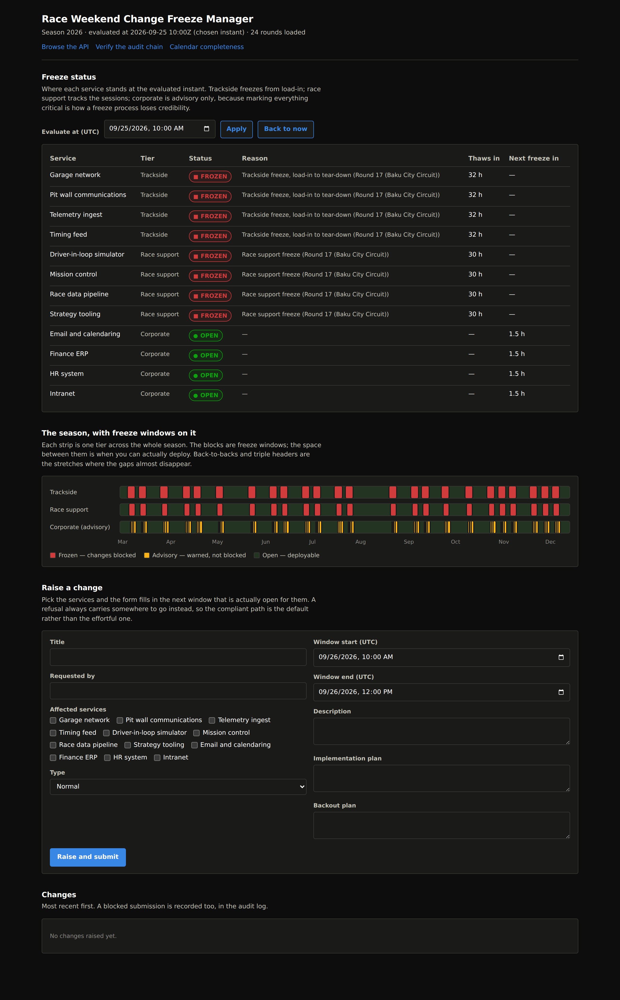

# Development

Everything needed to build, test, migrate and understand the ingestion path. The reader-facing
tour is in the [README](../README.md); the endpoint list is in [`api.md`](api.md); the design
record is in [`decisions.md`](decisions.md).

## Build

Requires the .NET 10 SDK. No other tooling — no npm, no bundler.

```bash
dotnet restore FreezeManager.slnx
dotnet build FreezeManager.slnx --configuration Release
dotnet test  FreezeManager.slnx --configuration Release
```

Warnings are errors. Note that an incremental build does not re-run the analysers, so a warning
introduced since the last full build can hide until CI or a clean rebuild finds it — build clean
before claiming the suite is quiet.

### The one skipped test

One test calls the real calendar API and is skipped by default so CI and offline runs stay
deterministic. To run it from a machine that can reach `api.jolpi.ca`:

```bash
FREEZE_LIVE_TESTS=1 dotnet test tests/FreezeManager.Infrastructure.Tests --filter LiveJolpica
```

## Migrations

Schema changes go through EF Core migrations:

```bash
dotnet tool install --global dotnet-ef

dotnet ef migrations add <Name> \
  --project src/FreezeManager.Infrastructure \
  --startup-project src/FreezeManager.Infrastructure \
  --output-dir Persistence/Migrations
```

The infrastructure tests build their in-memory database through the migrations rather than through
`EnsureCreated`, so a migration that does not match the model fails the suite instead of failing on
someone's machine after a deploy.

Applied automatically on first run of the API, along with seeding the service catalogue and the
first calendar pull.

## Calendar ingestion

`IRaceCalendarProvider` has two implementations. `JolpicaCalendarProvider` reads the live API
(Ergast-compatible response shape). `SeedCalendarProvider` reads the bundled file.
`FallbackCalendarProvider` tries the first and, on any failure, uses the second and says so in the
sync history.

`CalendarSyncService` reconciles what a provider returns into the database. It refreshes scheduled
times, never overwrites actual times a person recorded, keeps parc fermé windows a person entered,
and skips any event an admin has pinned.

The upstream API publishes session start times only. Durations and parc fermé are filled from
`IngestionDefaults`, and every derived parc fermé window is stamped as derived so a person can tell
a rule's output from a published fact.

Two things an operator has to act on are returned as their own fields rather than buried in warning
prose: `unmappedCircuitIds` (each one a row to add to the time-zone table) and `skippedRounds`
(each one a round upstream sent that could not be stored, with the reason).

### Regenerating the bundled seed

The seed is a build artefact of a verified sync, not a hand-maintained file:

```bash
curl -s localhost:5000/api/calendar/2026/seed-export > data/seed/calendar-2026.json
```

Drift between the seed and the last verified sync is checked at startup and at
`GET /api/calendar/{season}/seed-drift`.

`tools/generate-seed-calendar.py` is the script that produced the seed currently committed, back
when the file was hand-maintained. It is superseded by the export above and kept only so the
seed's `generatedBy` field resolves to something real.

### What a cold start with no network does

Worth knowing, because it is the path a reviewer on a locked-down machine will take. The live
provider fails, `FallbackCalendarProvider` uses the seed and records why, every seeded round is
reported as unverified in the sync message, and the seed-drift check says there is nothing to
compare against yet because no published-source sync has run. The app comes up, the dashboard
works, and nothing silently claims the dates are real:

```
warn: FallbackCalendarProvider  Calendar sync for season 2026 from Seed file (calendar-2026.json):
      24 added, 0 updated, 0 pinned, 25 warnings, unmapped circuits: none, rounds dropped: none.
info: Startup  Seed check for 2026: No sync from a published source has run yet, so there is
      nothing to compare the seed against.
```

`tools/demo-data.sh` works on that cold start too — it asks the engine which windows are frozen
rather than hard-coding dates, so it produces its refusal, its reschedule and its override against
whatever calendar the app managed to load.

## Test library choices

Tests use xUnit with its built-in assertions and no third-party assertion library, to keep the test
project free of the licence change that affected FluentAssertions v8.

The domain test project has no package references beyond the test SDK, matching the domain project
itself: no mocking library, because there is nothing to mock in a pure function.

## Dashboard styling and accessibility

The dashboard is Blazor Server with hand-written CSS — no build step, no component library.

Status colours come from a validated palette. Because the warning step sits below 3:1 contrast on a
light surface by design, every status mark carries an icon and a word as well as a colour, so colour
is never the only signal. The page follows the viewer's theme, with the dark steps chosen against
the dark surface rather than flipped:



## Phase history

Built in six phases, each ending in a review.

| Phase | Scope |
| --- | --- |
| 0 | Repository scaffold, CI |
| 1 | Domain: race calendar model, freeze engine, test suite |
| 2 | Persistence, calendar ingestion (live provider with seeded fallback) |
| 3 | API: change request lifecycle and freeze gate |
| 4 | Approval chains, emergency override, audit hash chain |
| 5 | Freeze dashboard, browsable API, calendar completeness |
| 6 | README and screenshots |
